<div align="center">

<!-- Header Animated Typing Banner -->
<a href="https://github.com/ShreyasN707">
  
</a>
<br/>


<p align="center">
  
  &nbsp;
  
  &nbsp;
  
  &nbsp;
  
</p>

</div>

<br/>

<!-- =================================================== -->
<!-- Flagship Section: Binary Avatar Terminal Interface -->
<!-- =================================================== -->

<div align="center">
  
</div>

<br/>

<div align="center">
<details>
  <summary><b>👾 Click to inspect raw binary matrix stream (0 &amp; 1)</b></summary>
  <br/>
  <div align="left">

```text
                      000000
                   0111100000000
                 01111000000000110
               011111000000000001100
              01111100000000000111100
             01111110000000111000010110
             11111110000000110010000111
            0111111100000000110110000110
           01111111000000000100111001111
           01111111100000000010111111111100011111111111
           01111111100000100111111111111111111111111110
           011111111000000011111111111111111100001110
            111111111111011111111111111111111111111
            1111111111111111111111111111111111100
       00011111111111111111111111111111111100
    01111111111111111111111111111110000
  01111111111111111111111111100
 111111111111111111111111110
011000111111111111111111000
110101111111111111111100
011111111111111111110
 0111110111111110
   0   01100000
```

  </div>
</details>
</div>

<br/>

<!-- =================================================== -->
<!-- About Me & Directives                               -->
<!-- =================================================== -->

### 🧭 About & Core Directives

> *"Just fun building cool CV stuff with good backend."*

I am a **Backend Engineer** and **AI / Computer Vision Explorer** focused on architecting resilient server-side infrastructures and high-speed visual processing pipelines. I bridge the gap between machine intelligence and production-grade engineering.

- ⚡ **Backend Systems**: Architecting high-throughput RESTful services, async event queues, low-latency caching, and containerized deployments.
- 👁️ **Computer Vision & AI**: Building real-time video stream analyzers, object detection workflows, and intelligent perception models.
- 🎬 **Visual Storytelling**: Integrating creative video editing concepts with automated media processing workflows.
- 💬 **Ask me about**: Python, FastAPI, Node.js, Docker, Computer Vision pipelines, and database optimization.

<br/>

<!-- =================================================== -->
<!-- Tech Arsenal                                        -->
<!-- =================================================== -->

### 🛠️ Tech Arsenal

<div align="center">

| Domain | Technologies |
| :--- | :--- |
| **Languages** |  |
| **Backend & APIs** |  |
| **Databases & Cache** |  |
| **DevOps & Environment** |  |
| **Frontend & Styling** |  |

</div>

<br/>

<!-- =================================================== -->
<!-- GitHub Animations & Telemetry                       -->
<!-- =================================================== -->

### 📊 Telemetry & Activity

<!-- Contribution Snake Animation -->
<div align="center">
  <p><b>Contribution Stream &amp; Snake Grid</b></p>
  <picture>
    <source media="(prefers-color-scheme: dark)" srcset="https://raw.githubusercontent.com/ShreyasN707/ShreyasN707/output/github-snake-dark.svg">
    <source media="(prefers-color-scheme: light)" srcset="https://raw.githubusercontent.com/ShreyasN707/ShreyasN707/output/github-snake.svg">
    
  </picture>
</div>

<br/>

<!-- GitHub Stats & Top Languages -->
<div align="center">
  <table border="0" cellspacing="10" cellpadding="0" style="background-color: transparent;">
    <tr>
      <td>
        
      </td>
      <td>
        
      </td>
    </tr>
  </table>
  <br/>
  <!-- GitHub Streak Stats -->
  
</div>

<br/>

<!-- Profile Trophies -->
<div align="center">
  <p><b>GitHub Achievements</b></p>
  
</div>

<br/>

<!-- Activity Graph -->
<div align="center">
  <p><b>Contribution Activity</b></p>
  
</div>

<br/>

<!-- =================================================== -->
<!-- Connect & Uplink                                    -->
<!-- =================================================== -->

### 🌐 Uplink & Connect

<div align="center">

<a href="https://www.linkedin.com/in/shreyas-naik-44717b332" target="_blank">
  
</a>
&nbsp;
<a href="mailto:shreyasnaik81@gmail.com">
  
</a>
&nbsp;
<a href="https://www.instagram.com/shreyas__n?igsh=MW0yZ2trazV4cXZvYw==" target="_blank">
  
</a>
&nbsp;
<a href="https://github.com/ShreyasN707" target="_blank">
  
</a>

</div>

<br/><br/>

<!-- =================================================== -->
<!-- Footer Sign-off                                     -->
<!-- =================================================== -->

<div align="center">
  
</div>
